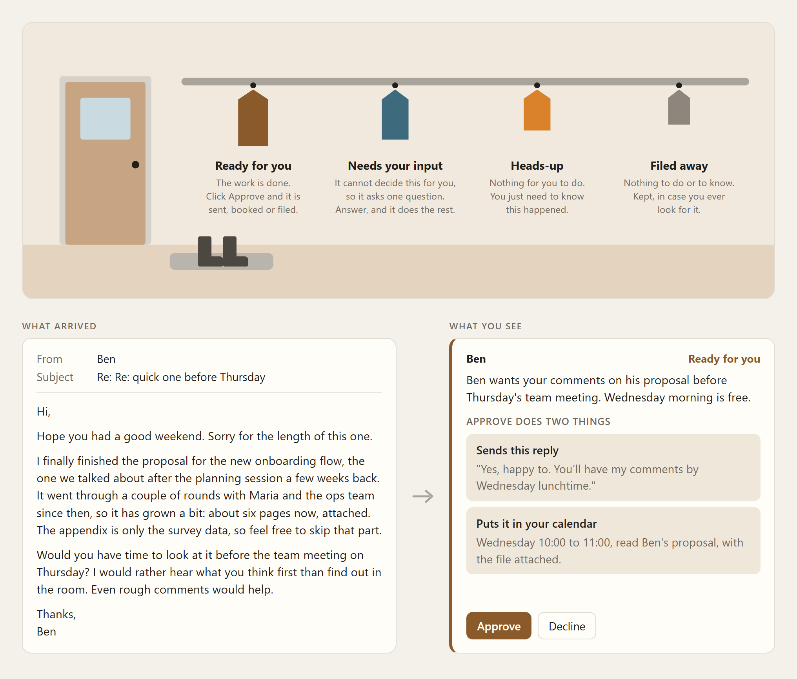

# The Mudroom

**An inbox that sorts itself, keeps everything on your own computer, and sends nothing until you say yes.**

A mudroom is where you drop your coat and boots before you go into the house. The Mudroom
does that for everything that comes at you: it reads your mail, messages, notes, invitations
and meeting transcripts and sorts them onto four hooks. Your own Claude Code does the reading. A small Python program checks everything
Claude proposes before it is saved. Nothing is sent, booked or filed until you click yes.
Later, when you trust it, you can let it handle some things on its own. It keeps no
passwords, and it comes with a working demo, so you can see how it behaves before you
connect your own accounts.



## Try the demo first: a week in ten minutes

The repository comes with a complete, working copy of the system and an invented week to
run it on. Nothing is connected to your life yet. You play four days of someone else's mail
and decide whether you like how it works.

Clone it, or on GitHub choose Code > Download ZIP and unpack it (on Windows: right-click,
Extract All). Open the folder that holds `mudroom.py` in
[Claude Code](https://claude.com/claude-code); after unpacking that is the inner
`the-mudroom-main` folder. Then say:

```
/start
```

The Mudroom opens in your browser. You play Alex, who runs a small bakery. The owner wants
to know when the new shop opens. At home there is a partner, a nine-year-old and a mother
who is unwell. Over four days their mail, messages and notes arrive. You move the clock,
watch each batch get sorted, approve what is ready, send back what is not, and teach it a
rule.

The people write back. If you are rude to them, they remember.

You need Python 3.12 or newer, Claude Code logged in, and on Windows Git for Windows. The
Mudroom is free. The sorting runs on your own Claude plan, so you need a Claude
subscription. The Mudroom holds no keys.

Missing something? `/start` checks the machine first and offers to install what is not
there, asking before each step. On Windows that is usually Python and Git: `winget install
-e --id Python.Python.3.12` and `winget install -e --id Git.Git`, then close and reopen
Claude Code. Claude Code needs Git's Bash on Windows to run the sorting. If typing `python`
opens the Microsoft Store, switch off python.exe and python3.exe under Settings > Apps >
Advanced app settings > App execution aliases. You can run the same check yourself at any
time with `python mudroom.py doctor`.

It was designed and tested with Claude Code. Other coding agents that pick up skills from a
folder, Codex for one, should work too, but we have not tried them and make no promises.
If you do, tell us how it went.

## Then make it yours

Say `/make-it-mine`. It asks your name, removes the demo, connects your first inbox, locks
that connection to reading, and runs the first pass, one step at a time.

From then on, you say the name of your source in Claude Code, `/source-gmail` for one, and
everything new is brought in and sorted before you read it. Replies are drafted. Promises
are tracked both ways: what you said you would do, and what others said they would do for
you.

At first it asks you before it does anything. When you trust it, you can let it handle some
things on its own. For example: "file the newsletters without asking". You say yes to that
rule once. After that it files newsletters by itself, and every time it does, the log shows
it. Every rule you teach is listed in plain words under House rules, with how often it
fired and a Remove button. Remove the rule and it stops.

What you approve and teach it is done in your name, so read it first. It comes without warranty, as the licence says. The Mudroom is shared for
inspiration and is not supported software: you are responsible for what you do with your
copy. See [SECURITY.md](SECURITY.md).

It is your code, too. Small enough to read in an afternoon. Change anything you like.

## What stays home

Your items, the rules you teach, the promises it tracks and the log of everything it did
stay in a database in this folder. There is no A-Zero server. The reading is done by a
language model: as shipped, that is Claude, so the text of each item goes to Anthropic
through your own Claude account, under your plan's terms. As shipped, the Mudroom sends
nothing for you: a reply you approve waits on the Doorstep, marked not sent, for you to send
from your own mail. Connect it to your mail if you want it to send. Incoming mail can try to trick an AI, which is why the model may only read what
the engine prints and hand in one file, and a small Python check and your yes, on a card or
once for a rule, stand between that file and anything that happens.

The Mudroom is meant as inspiration and scaffolding: a starting point to make your own.
The piping is there for you to tweak and adjust as you want. The model, for one, is called
in one place, `engine/agents.py`, so you can swap in another one, including a model that
runs entirely on your own machine. It needs to be able to follow the skills in
`.claude/skills` and use tools; we have not tried that ourselves, so tell us how it goes.

## Under the hood

The page *Inspect the piping*, inside the Mudroom, shows how the parts fit together.
`docs/make-it-yours.md` lists what a real setup still needs.

## Made from zero

Somewhere in the north of the Netherlands, a small non-profit is turning wild ideas into
working software and giving it away. That's us!

[A-Zero](https://www.a-zero.org) is a registered Dutch non-profit. We build tools that make
people's lives better, we back small businesses that dare to try something new, and
everything we make is free to use and free to change. That runs on coffee. If the Mudroom
gave you an evening back, or you want to see what we build next,
[buy A-Zero a coffee](https://buymeacoffee.com/azerolabs) before we run out.

Apache-2.0 licensed; see LICENSE and NOTICE.
